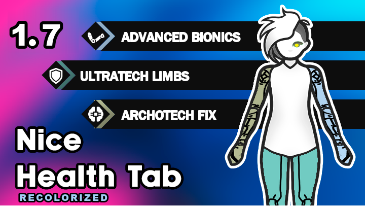

# Nice Health Tab: Recolorized

[](https://rimworldgame.com/)
[](LICENSE)
[](https://github.com/gfrov/NiceHealthTab-Recolorized/releases)

A visual enhancement and customization mod for [Nice Health Tab](https://steamcommunity.com/sharedfiles/filedetails/?id=3328729902) in RimWorld. Features an interactive in-game HSV color palette, dynamic dominant-limb body silhouette tinting, synchronized hand/foot indicators, Archotech authentic color restoration, and seamless graphics integration with [Yet another prosthetic expansion mod (YAPEM)](https://steamcommunity.com/sharedfiles/filedetails/?id=2808872704).



---

## Key Features

### 1. Interactive In-Game HSV Color Palette
Customize the exact color of any prosthetic/implant category directly from RimWorld's Mod Settings:
- **Advanced Bionics** (default: `#A1CEF3` soft cyan-blue)
- **Ultratech Limbs** (default: `#71CBC2` mint turquoise)
- **Archotech Limbs** (default: `#CBD0AB` authentic sage-green)
- **Standard Bionics** (default: `#E6E6E6` sleek grey-white)
- **Simple Prosthetics** (default: `#D9D9D9`)

> Includes RimWorld's native circular Hue wheel and Saturation/Value diamond, color presets, live preview on your colonist, HEX input, and one-click reset to default!

### 2. Dynamic Dominant Body Silhouette Tinting
- When a colonist undergoes cybernetic enhancement, the background doll silhouette tints to reflect their dominant prosthetic tier!
- **Configurable threshold slider**: Require 1, 2, 3 (default), or all 4 limbs of the same category to trigger body recoloring.
- Completely optional: can be toggled on or off at any time.

### 3. Synchronized Hand & Foot Icons
- Separate bottom hand and foot icons dynamically inherit the precise color of the installed limb prosthetics.

### 4. YAPEM Doll Graphics Expansion
- Complete graphical doll coverage for Advanced Bionic and Ultratech arms, legs, eyes, and organs across all body types (Female, Male, Hulk, Fat).
- Integrates seamlessly into Nice Health Tab / Nicer Health Tab.

### 5. Authentic Archotech Restoration
- Replaces overly saturated radioactive-green textures with lore-accurate sage-green (`#CBD0AB`).

### 6. Universal Mod Compatibility
- Dynamically categorizes implants from any mod (e.g. *Archotech Expanded*, *EPOE-Forked*, *More Archotech Implants*, etc.) by scanning `TechLevel.Archotech`, `defName`, and bilingual label markers.

### 7. Multi-Language Localization
Fully localized into **18 languages**:
English, Russian, French, German, Italian, Spanish (EU & LatAm), Brazilian Portuguese, Japanese, Korean, Simplified Chinese, Traditional Chinese, Turkish, Ukrainian, Vietnamese, Polish, Czech, and Hungarian.

---

## Load Order

Arrange your mod list in the following order:

```text
1. Harmony
2. Core
... (DLCs)
3. Nice Health Tab
4. Nicer Health Tab (optional)
5. Yet another prosthetic expansion mod - Core (optional)
6. Nice Health Tab: Recolorized  <-- [This Mod]
```

---

## Development & Building

The C# solution targets `.NET 10.0` (matching RimWorld 1.7) and cross-compiles cleanly:

```bash
# Clone the repository
git clone https://github.com/gfrov/NiceHealthTab-Recolorized.git
cd NiceHealthTab-Recolorized

# Build the assembly
dotnet build Source/NiceHealthTab_YAPEM_Patch.csproj -c Release
```

---

## Branching Strategy

- `main`: Production-ready release branch matching Steam Workshop versions.
- `develop`: Active feature development, bugfixes, and experimental patches.
- Release tags: `v1.0.0`, `v1.1.0`, etc.

---

## License

This project is licensed under the [MIT License](LICENSE).
RimWorld is a trademark of Ludeon Studios.
Nice Health Tab is created by Andromeda.
YAPEM is created by MrKociak.
